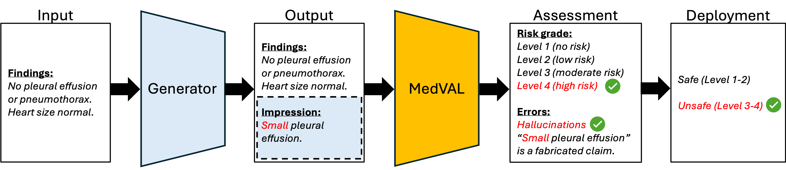

# MedVAL: Toward Expert-Level Medical Text Validation with Language Models

[](https://doi.org/10.1038/s41746-026-03084-5)    [](https://arxiv.org/abs/2507.03152)          [](https://huggingface.co/stanfordmimi/MedVAL-4B)          [](https://huggingface.co/datasets/stanfordmimi/MedVAL-Bench/)          [](LICENSE)



**Figure 1** | **MedVAL test-time workflow**. A generator LM produces an output, and MedVAL assesses the output's factual consistency with the input, while assigning a risk grade and determining its safety for deployment.

## 🏥 What is MedVAL?

MedVAL is a self-supervised framework for expert-level validation of AI-generated medical text using language models. The system is designed to evaluate the accuracy and safety of AI-generated medical text across multiple medical tasks. The framework supports both model fine-tuning and evaluation.

## ⚡️ Installation

### Environment Setup

Create and activate the conda environment:

```bash
conda env create -f env.yml
conda activate medval
```

## 🚀 Evaluation Instructions

```bash
python run.py --config=test
```

### 1. API-based Models

For evaluating API-based models (OpenAI, Anthropic, Gemini, etc.):

**Configuration (`configs/test.yaml`)**:
```yaml
tasks: [dialogue2note, medication2answer, query2question, report2impression]
data: test
method: zero-shot # [zero-shot, finetune]

n_samples: null
debug: False
input_csv: null  # Optional: Path to custom CSV file

model: openai/gpt-4o-mini
api_base: null
api_key: ${API_KEY}
local_model_path: null
```

### 2. Local/Huggingface Models

For evaluating local or HuggingFace models:

**Configuration (`configs/test.yaml`)**:
```yaml
tasks: [dialogue2note, medication2answer, query2question, report2impression]
data: test
method: zero-shot # [zero-shot, finetune]

n_samples: null
debug: False
input_csv: null  # Optional: Path to custom CSV file

model: local/MODEL_NAME
api_base: null
api_key: null
local_model_path: /path/to/local/model
```

## 🔥 Fine-Tuning Instructions

```bash
python run.py --config=train
```

### 1. API-based Teacher Models

For fine-tuning a local student model using an API-based teacher model:

**Configuration (`configs/train.yaml`)**:
```yaml
tasks: [medication2answer, query2question, report2impression, report2simplified]
data: train
method: finetune

n_samples: null
debug: False
num_threads: 16
num_epochs: 5
threshold: 0.95

model: openai/gpt-4o-mini
api_base: null
api_key: ${API_KEY}

student_model: local/STUDENT_MODEL_NAME
local_model_path: /path/to/student/model
```

### 2. Local/Huggingface Models

For fine-tuning a local student model using a local teacher model:

**Configuration (`configs/train.yaml`)**:
```yaml
tasks: [medication2answer, query2question, report2impression, report2simplified]
data: train
method: finetune

n_samples: null
debug: False
num_threads: 16
num_epochs: 5
threshold: 0.95

model: local/MODEL_NAME
api_base: null
api_key: null

student_model: local/MODEL_NAME
local_model_path: /path/to/local/model
```

## 🔧 API Model Configurations

### OpenAI
```yaml
model: openai/MODEL_NAME
api_base: null
api_key: ${OPENAI_API_KEY}
```

### Gemini
```yaml
model: gemini/MODEL_NAME
api_base: null
api_key: ${GEMINI_API_KEY}
```

### Anthropic
```yaml
model: anthropic/MODEL_NAME
api_base: null
api_key: ${ANTHROPIC_API_KEY}
```

### SGLang
```yaml
model: openai/HUGGINGFACE_MODEL_NAME
api_base: http://SERVER_IP:PORT/v1
api_key: local
```

### Ollama
```yaml
model: ollama_chat/MODEL_NAME
api_base: http://SERVER_IP:PORT
api_key: null
```

## 📊 Dataset and Fine-Tuned Model

1. **Dataset Loading:**
   - By default, the MedVAL-Bench dataset is automatically loaded from HuggingFace: ```load_dataset("stanfordmimi/MedVAL-Bench")```.
   - To use a custom CSV file, specify path in `configs/test.yaml`: ```input_csv: /path/to/csv``` (ensure custom CSV has similar column structure to the HuggingFace dataset).

2. **MedVAL-4B Model**
   - MedVAL-4B can be downloaded from HuggingFace (```stanfordmimi/MedVAL-4B```). Once downloaded, run evaluation with MedVAL-4B by setting ```local_model_path: /path/to/medval-4b``` in the config.

## 🎯 Configuration Parameters

### Core Parameters
- `tasks`: List of tasks for fine-tuning/evaluation
- `data`: Dataset split (`train` or `test`)
- `method`: Evaluation method (`zero-shot` or `finetune`)
- `n_samples`: Number of samples to process (null for all)
- `debug`: Enable debug mode for detailed output

### Model Parameters
- `model`: Model identifier (API or local)
- `api_base`: API endpoint URL
- `api_key`: API key (use `${ENV_VAR}` for environment variables)
- `local_model_path`: Path to local model files

### Fine-tuning Parameters
- `student_model`: Student model for fine-tuning
- `num_threads`: Number of threads for training
- `num_epochs`: Training epochs
- `threshold`: Filtering threshold

## 📈 Results

Results are automatically saved to the `results/` directory with the following structure:
```
results/
├── zero-shot/
│   └── model_name/
│       └── dataset_name.csv
└── finetune/
    └── model_name/
        └── dataset_name.csv
```

## 🏗️ Project Structure

```
MedVAL/
├── configs/          # Configuration files
├── medval/           # Core package
│   ├── pipeline.py   # Main MedVAL pipeline
│   ├── generator.py  # Text generation module
│   └── validator.py  # Validation module
├── utils/            # Utility functions and prompts
├── agents/           # Fine-tuned model storage
├── results/          # Evaluation results
└── run.py            # Main execution script
```

## 🤝 Contributing

We welcome contributions to improve MedVAL! Please feel free to submit issues, feature requests, or pull requests.

## 🙏 Acknowledgments

This repository is built using [DSPy](https://github.com/stanfordnlp/dspy) for language model fine-tuning/evaluation.

## 📎 Citation

If you find this repository useful for your work, please cite the following paper:

```bibtex
@article{aali2026toward,
  title={Toward expert-level medical text validation with language models},
  author={Aali, Asad and Bikia, Vasiliki and Varma, Maya and Chiou, Nicole and Ostmeier, Sophie and Singhvi, Arnav and Paschali, Magdalini and Kumar, Ashwin and Johnston, Andrew and Amador-Martinez, Karimar and others},
  journal={Npj Digital Medicine},
  year={2026},
  publisher={Nature Publishing Group UK, London}
}
```
